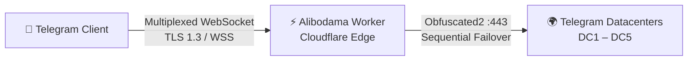

<div align="center">

[فارسی](README.md) · **English**

</div>

<div align="center">

# ⚡ Alibodama

**Secure, high-speed Telegram Web Proxy — fully serverless, running on the Cloudflare edge**

A stable connection to Telegram with no extra applications — just one domain and one code file.


</div>

---

## 📖 Introduction

**Alibodama** is a dedicated Telegram Web Proxy that runs entirely on Cloudflare's edge infrastructure. Deploy it once on your Worker or Pages; from then on, your own dashboard — with a QR code and a one-click connect link — hooks any device and any up-to-date Telegram client into the Telegram network within seconds.

Unlike conventional proxies, Alibodama needs no intermediate server, no database, and no third-party service. All of the encryption, multiplexing and connection-management logic lives inside that single code file and executes on the Cloudflare node closest to the user.

---

## ✨ Key Features

| Feature | Description |
|---|---|
| ☁️ Two Platforms | One single codebase — runs on both **Cloudflare Workers** and **Pages** (Advanced Mode) |
| 🔐 Obfuscated2 Encryption | Handshake and encryption are performed inside the Worker; traffic keys are never stored on the server |
| ⚡ Zero-Copy Download | Download path without re-decryption; maximum speed with minimal CPU usage |
| 🌍 Automatic Datacenter Selection | Intelligent connection to Telegram DC1–DC5 with sequential failover and controlled timeouts |
| 🔀 Multi-Stream Multiplexing | Dozens of parallel connections over a single WebSocket with Flow Control |
| 🛡 Stateless Sessions | HMAC-SHA256 signed tokens with short TTL; no database and no server-side sessions |
| 📊 Bilingual Dashboard | Persian/English interface with QR code, copy link and a direct-connect button |
| 🥸 Camouflage Mode | Optionally show a different website to ordinary browser visitors |
| 💸 Free Plan | No special compatibility flags required; runs perfectly on Cloudflare's Free plan |

---

## 🏗 Architecture & How It Works



**The path of a connection, in four steps:**

1. The Telegram client connects through your dashboard and opens a secure WebSocket session.
2. The client's 64-byte handshake is decoded inside the Worker and the destination (the Telegram datacenter) is extracted.
3. The Worker opens a direct socket to the destination datacenter and plants the client's download key into the datacenter handshake, so download traffic arrives without re-decryption (Zero-Copy).
4. Upload traffic is re-encrypted with the datacenter key and carried over the same multiplexed WebSocket; all frames are managed with flow control and short-lived HMAC tokens.

---

## 📂 Project Structure

```
.
├── Alibodama-Worker/
│   ├── worker.js          ← Main code for Cloudflare Workers
│   └── wrangler.toml      ← CLI deployment configuration
├── Alibodama-Pages/
│   ├── _worker.js         ← Same code for Pages Advanced Mode
│   └── wrangler.toml      ← CLI Pages deployment configuration
├── Alibodama-Pages-Upload.zip   ← Ready-made bundle for direct upload in the Pages dashboard
└── README.md
```

> Both code folders are identical in content; the only difference is the entry filename (`worker.js` vs `_worker.js`) and the deployment method.

---

## 🚀 Step-by-Step Setup

### Prerequisites

- A free [Cloudflare](https://dash.cloudflare.com/sign-up) account — the Free plan is enough
- About 5 minutes of your time
- Access to the files in this repo (the code is deployment-ready; no build or dependency installation is needed)

### Step 1 — Create the proxy secret (`PROXY_SECRET`)

This secret is the "lock key" of your proxy and is embedded in the Telegram connect link, so keep it **confidential**.

Generate a random 32-character hex value (in a terminal):

```bash
openssl rand -hex 16
```

- ✅ Valid format: exactly 32 hex characters (or with the `dd` prefix)
- ❌ If the value is invalid, the service responds to **all routes with 404** instead of showing an error — so be careful when copy/pasting
- ⚠️ If you don't set a secret, a public default is used, which is **not suitable** for public use; always set your own dedicated secret

### Step 2 — Deploy (choose one of four methods)

#### ☁️ Method A: Workers via the Dashboard (simplest — recommended)

1. Go to [dash.cloudflare.com](https://dash.cloudflare.com) → **Workers & Pages** menu → **Create** → **Workers** → **Create Worker**
2. Set the name to `alibodama` (or any name you like) → **Deploy**
3. Click **Edit code**; delete **all** of the default code and paste the full contents of `Alibodama-Worker/worker.js` → **Deploy**
4. From the Worker page → **Settings** → **Variables and Secrets** → **Add**:
   - Type: `Secret` | Name: `PROXY_SECRET` | Value: the secret created in Step 1
5. Hit **Deploy** again to activate the secret

✅ Your proxy is now available at `https://alibodama.<subdomain>.workers.dev`.

#### 🖥 Method B: Workers via the CLI (Wrangler)

```bash
# one time only
npm install -g wrangler
wrangler login

cd Alibodama-Worker
wrangler deploy

# register the secret (paste the value and press Enter)
wrangler secret put PROXY_SECRET
```

#### 📦 Method C: Pages via the Dashboard (direct upload)

1. Dashboard → **Workers & Pages** → **Create** → **Pages** tab → **Upload assets**
2. Project name: `alibodama` → drag & drop the **`Alibodama-Pages-Upload.zip`** file
3. Click **Deploy** → your address: `https://alibodama.pages.dev`
4. Set the secret: **Settings** → **Environment variables** → the **Production** section (and, to be safe, **Preview** too) → **Add variable**:
   - Name: `PROXY_SECRET` | Value: the Step 1 secret
5. ⚠️ In Pages, variables only take effect with a **Redeploy**: **Deployments** tab → the latest deployment → **Retry deployment**

> In Pages mode, every request (dashboard, API and WebSocket) is handled by `_worker.js`; no extra files or settings are needed.

#### 🧰 Method D: Pages via the CLI

```bash
cd Alibodama-Pages
wrangler pages deploy          # reads the settings from wrangler.toml
wrangler pages secret put PROXY_SECRET --project-name alibodama
```

### Step 3 — Health Check

| Check | Method | Expected Result |
|---|---|---|
| Dashboard access | Open the address in a browser | Dashboard with QR and a connect button |
| HTTP response | `curl -I https://<your-domain>/` | `HTTP/2 200` |
| Connect link | Inspect the `tg://webproxy?...` link inside the dashboard | Contains your domain and secret |

### Step 4 (optional) — Custom Domain

- **Workers:** Worker page → **Settings** → **Domains & Routes** → **Add Custom Domain**
- **Pages:** project page → **Custom domains** → **Set up a custom domain**

The dashboard and connect links automatically use the current domain; after attaching a domain, no code change is needed.

---

## ⚙️ Configuration Variables

| Variable | Type | Default | Description |
|---|---|---|---|
| `PROXY_SECRET` | **Secret (required for public use)** | — | The proxy secret; exactly 32 hex characters (or with the `dd` prefix). Changing it invalidates all previous links |
| `MAX_DIALS` | Text | `45` | Cap on concurrent streams per session; between `4` and `100000` |
| `CAMOUFLAGE_URL` | Text | empty | If set, ordinary browser visits show this URL's content instead of the dashboard (camouflage) |

> 💡 **Note on camouflage:** when `CAMOUFLAGE_URL` is set, the dashboard is no longer displayed at `/` and only the Telegram connect channel remains active. To see the dashboard again, remove the variable and redeploy.

---

## 📲 Connecting in Telegram

1. Open the deployed address in a browser (e.g. `https://alibodama.pages.dev`)
2. The bilingual dashboard opens; switch the language with the **FA / EN** buttons
3. Use one of the three options:
   - Press **"Direct connect to Telegram"** (the proxy opens automatically in the app)
   - Scan the **QR code** with your phone camera
   - Copy and share the **share link** with friends
4. In the Telegram window that opens, tap **Connect Proxy** — done!

> No extra applications, manual settings or other VPNs are needed; the connection is established directly on the edge network.

---

## 🎨 Dashboard Customization

Two constants are defined at the top of the code file which you can change to your taste:

```js
const BRAND_NAME           = 'Alibodama';
const TELEGRAM_CHANNEL_URL = 'https://t.me/alibodama';
```

- `BRAND_NAME` — the display name in the dashboard banner and footer
- `TELEGRAM_CHANNEL_URL` — the Telegram channel link on the dashboard banner

After editing, just deploy once.

---

## 🔍 Troubleshooting

| Symptom | Possible Cause | Solution |
|---|---|---|
| Everything is 404 (even the dashboard) | `PROXY_SECRET` is invalid (wrong format) or the code was pasted incompletely | The secret must be exactly 32 hex characters; paste the complete code and redeploy |
| The dashboard opens but a different site appears | `CAMOUFLAGE_URL` is set | Intentional camouflage behavior; to remove it, clear the variable and redeploy |
| Telegram won't connect | Old link, changed secret, or an outdated Telegram version | Get a fresh link from the dashboard; update Telegram to the latest version |
| `Error 1101` / `1102` in the Worker | Runtime error inside the code or a wrong variable | Verify the variables and code completeness, then redeploy |
| Variable changes had no effect | In Pages, variables only apply with a new deployment | Create a new deployment or hit Retry deployment |
| White or blank page | Browser cache | Reload with `Ctrl + F5` |

---

## ❓ FAQ

<details>
<summary><b>Does it work on Cloudflare's free plan?</b></summary>

Yes. The code uses `cloudflare:sockets` only on port 443 and needs no compatibility flag, Durable Object, KV or Cron. The `compatibility_date` in `wrangler.toml` is already set to a stable value.
</details>

<details>
<summary><b>Is my data stored?</b></summary>

No. There is no database, log or server-side session. Traffic is only relayed between the client and the official Telegram datacenter, and Telegram's own end-to-end encryption remains intact; the Worker only manages the transport layer.
</details>

<details>
<summary><b>What is the capacity and concurrent-user limit?</b></summary>

Each WebSocket session supports up to 45 parallel streams, which can be raised to 100,000 via `MAX_DIALS`. The final ceiling is determined by your Cloudflare plan and account limits.
</details>

<details>
<summary><b>What should I do if the proxy secret leaks?</b></summary>

Simply replace `PROXY_SECRET` with a new random value and redeploy; all previous links are invalidated immediately and new links are available from the dashboard.
</details>

---

## 🔐 Security Notes

- **Keep the proxy secret confidential** — anyone who has the secret can use your Worker
- If the secret leaks, change it **immediately** (previous links are invalidated automatically)
- Monitor your Worker's usage and traffic via the **Analytics** section of the Cloudflare dashboard
- To reduce attention from ordinary visitors, use **Camouflage Mode** (`CAMOUFLAGE_URL`)

---

## 📄 License

This project is released under the MIT License — free to use, modify and distribute.

<div align="center">

**Alibodama — Your own private Telegram proxy, on the Cloudflare edge ⚡**

</div>
