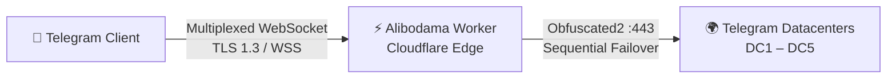

<div dir="rtl" align="center">

**فارسی** · [English](README.en.md)

</div>

<div dir="rtl" align="center">

# ⚡ Alibodama

**وب‌پروکسی امن و پرسرعت تلگرام — کاملاً سرورلس، اجرا روی شبکهٔ لبهٔ Cloudflare**

اتصال پایدار به تلگرام بدون هیچ اپلیکیشن جانبی، فقط با یک دامنه و یک فایل کد.


</div>

---

<div dir="rtl">

## 📖 معرفی

**Alibodama** یک وب‌پروکسی اختصاصی تلگرام است که به‌صورت کامل روی زیرساخت لبهٔ Cloudflare اجرا می‌شود. کافی است یک‌بار روی Worker یا Pages خود دیپلوی کنید؛ پس از آن داشبورد اختصاصی شما با QR کد و لینک اتصال یک‌کلیکی، هر دستگاه و هر نسخهٔ به‌روز تلگرام را در چند ثانیه به شبکهٔ تلگرام وصل می‌کند.

برخلاف پروکسی‌های متعارف، Alibodama به هیچ سرور واسطه، دیتابیس یا سرویس شخص ثالث نیاز ندارد. تمام منطق رمزنگاری، مالتی‌پلکس و مدیریت اتصال درون همان یک فایل کد و روی نزدیک‌ترین نود کلادفلر به کاربر انجام می‌شود.

</div>

---

<div dir="rtl">

## ✨ ویژگی‌های کلیدی

| ویژگی | توضیح |
|---|---|
| ☁️ دو پلتفرم | یک کد واحد — هم روی **Cloudflare Workers** و هم روی **Pages** (حالت Advanced) |
| 🔐 رمزنگاری Obfuscated2 | هندشیک و رمزنگاری به‌صورت درون‌ورکری انجام می‌شود؛ کلیدهای ترافیک هرگز در سرور ذخیره نمی‌شوند |
| ⚡ دانلود Zero-Copy | مسیر دانلود بدون رمزگشایی مجدد؛ حداکثر سرعت با حداقل مصرف CPU |
| 🌍 انتخاب خودکار دیتاسنتر | اتصال هوشمند به DC1 تا DC5 تلگرام با failover ترتیبی و timeout کنترل‌شده |
| 🔀 مالتی‌پلکس چند استریم | ده‌ها اتصال موازی روی یک WebSocket واحد با کنترل جریان (Flow Control) |
| 🛡 نشست بدون حالت (Stateless) | توکن‌های امضاشدهٔ HMAC-SHA256 با TTL کوتاه؛ بدون دیتابیس و بدون نشست سمت سرور |
| 📊 داشبورد دوزبانه | رابط فارسی/انگلیسی با QR کد، کپی لینک و دکمهٔ اتصال مستقیم |
| 🥸 حالت استتار | امکان نمایش یک سایت دیگر به بازدیدکنندگان معمولی مرورگر |
| 💸 پلن رایگان | بدون نیاز به فلگ سازگاری خاص؛ روی پلن Free کلادفلر به‌خوبی اجرا می‌شود |

</div>

---

<div dir="rtl">

## 🏗 معماری و نحوهٔ کار

<div dir="ltr">



</div>

**مسیر یک اتصال، در چهار گام:**

1. کلاینت تلگرام از طریق داشبورد شما به پروکسی وصل می‌شود و یک نشست WebSocket امن باز می‌کند.
2. هندشیک ۶۴ بایتی کلاینت درون ورکر رمزگشایی می‌شود و مقصد (دیتاسنتر تلگرام) استخراج می‌گردد.
3. ورکر یک سوکت مستقیم به دیتاسنتر مقصد باز می‌کند و کلید دانلود کلاینت را در هندشیک دیتاسنتر جاسازی می‌کند تا ترافیک دانلود بدون رمزگشایی مجدد (Zero-Copy) برسد.
4. ترافیک آپلود با کلید دیتاسنتر دوباره رمز شده و روی همان WebSocket مالتی‌پلکس منتقل می‌شود؛ همهٔ فریم‌ها با کنترل جریان و توکن‌های موقت HMAC مدیریت می‌شوند.

</div>

---

<div dir="rtl">

## 📂 ساختار پروژه

<div dir="ltr">

```
.
├── Alibodama-Worker/
│   ├── worker.js          ← کد اصلی برای Cloudflare Workers
│   └── wrangler.toml      ← پیکربندی دیپلوی CLI
├── Alibodama-Pages/
│   ├── _worker.js         ← همان کد برای حالت Advanced Mode در Pages
│   └── wrangler.toml      ← پیکربندی دیپلوی Pages با CLI
├── Alibodama-Pages-Upload.zip   ← بستهٔ آماده برای آپلود مستقیم در داشبورد Pages
└── README.md
```

</div>

> هر دو پوشهٔ کد از نظر محتوا کاملاً یکسان‌اند؛ تفاوت فقط در نام فایل ورودی (`worker.js` در برابر `_worker.js`) و نحوهٔ دیپلوی است.

</div>

---

<div dir="rtl">

## 🚀 راه‌اندازی قدم‌به‌قدم

### پیش‌نیازها

- یک حساب رایگان [Cloudflare](https://dash.cloudflare.com/sign-up) — پلن Free کافی است
- حدود ۵ دقیقه وقت
- دسترسی به فایل‌های این ریپو (کد آمادهٔ دیپلوی است؛ هیچ Build یا نصب وابستگی لازم نیست)

### گام ۱ — ساخت رمز پروکسی (`PROXY_SECRET`)

این رمز، «کلید قفل» پروکسی شماست و داخل لینک اتصال تلگرام قرار می‌گیرد؛ پس آن را **محرمانه** نگه دارید.

یک مقدار تصادفی ۳۲ کاراکتری هگز بسازید (در ترمینال):

<div dir="ltr">

```bash
openssl rand -hex 16
```

</div>

- ✅ قالب مجاز: دقیقاً ۳۲ کاراکتر هگز (یا با پیشوند `dd`)
- ❌ اگر مقدار نامعتبر باشد، سرویس به‌جای نمایش خطا، **همهٔ مسیرها را با 404** پاسخ می‌دهد — پس در کپی/پیست دقت کنید
- ⚠️ اگر رمز را تنظیم نکنید، یک رمز پیش‌فرض عمومی استفاده می‌شود که برای استفادهٔ عمومی **مناسب نیست**؛ حتماً رمز اختصاصی تنظیم کنید

### گام ۲ — دیپلوی (یکی از چهار روش را انتخاب کنید)

#### ☁️ روش A: Workers از طریق داشبورد (ساده‌ترین — پیشنهادی)

1. وارد [dash.cloudflare.com](https://dash.cloudflare.com) شوید → منوی **Workers & Pages** → **Create** → **Workers** → **Create Worker**
2. نام را `alibodama` بگذارید (یا هر نام دلخواه) → **Deploy**
3. روی **Edit code** کلیک کنید؛ **تمام** کد پیش‌فرض را پاک کنید و کل محتوای `Alibodama-Worker/worker.js` را جای‌گذاری کنید → **Deploy**
4. از صفحهٔ ورکر → **Settings** → **Variables and Secrets** → **Add**:
   - Type: `Secret` | Name: `PROXY_SECRET` | Value: رمز ساخته‌شده در گام ۱
5. **Deploy** را دوباره بزنید تا رمز فعال شود

✅ پروکسی شما روی `https://alibodama.<subdomain>.workers.dev` در دسترس است.

#### 🖥 روش B: Workers با خط فرمان (Wrangler)

<div dir="ltr">

```bash
# یک بار برای همیشه
npm install -g wrangler
wrangler login

cd Alibodama-Worker
wrangler deploy

# ثبت رمز (مقدار را پیست کنید و Enter بزنید)
wrangler secret put PROXY_SECRET
```

</div>

#### 📦 روش C: Pages از طریق داشبورد (آپلود مستقیم)

1. داشبورد → **Workers & Pages** → **Create** → تب **Pages** → **Upload assets**
2. نام پروژه: `alibodama` → فایل **`Alibodama-Pages-Upload.zip`** را Drag & Drop کنید
3. **Deploy** را بزنید → آدرس شما: `https://alibodama.pages.dev`
4. تنظیم رمز: **Settings** → **Environment variables** → بخش **Production** (و برای اطمینان **Preview** هم) → **Add variable**:
   - Name: `PROXY_SECRET` | Value: رمز گام ۱
5. ⚠️ در Pages متغیرها فقط با یک **Redeploy** اعمال می‌شوند: تب **Deployments** → آخرین دیپلوی → **Retry deployment**

> در حالت Pages همهٔ درخواست‌ها (داشبورد، API و WebSocket) توسط `_worker.js` مدیریت می‌شود؛ فایل یا تنظیم اضافه‌ای لازم نیست.

#### 🧰 روش D: Pages با خط فرمان

<div dir="ltr">

```bash
cd Alibodama-Pages
wrangler pages deploy          # تنظیمات را از wrangler.toml می‌خواند
wrangler pages secret put PROXY_SECRET --project-name alibodama
```

</div>

### گام ۳ — تست سلامت

| بررسی | روش | نتیجهٔ مورد انتظار |
|---|---|---|
| دسترسی داشبورد | باز کردن آدرس در مرورگر | داشبورد با QR و دکمهٔ اتصال |
| پاسخ HTTP | `curl -I https://<دامنهٔ شما>/` | `HTTP/2 200` |
| لینک اتصال | بررسی لینک `tg://webproxy?...` داخل داشبورد | شامل دامنه و رمز شما |

### گام ۴ (اختیاری) — دامنهٔ اختصاصی

- **Workers:** صفحهٔ ورکر → **Settings** → **Domains & Routes** → **Add Custom Domain**
- **Pages:** صفحهٔ پروژه → **Custom domains** → **Set up a custom domain**

داشبورد و لینک‌های اتصال به‌صورت خودکار از دامنهٔ فعلی استفاده می‌کنند؛ بعد از اتصال دامنه، نیازی به تغییر کد نیست.

</div>

---

<div dir="rtl">

## ⚙️ متغیرهای پیکربندی

| متغیر | نوع | پیش‌فرض | توضیح |
|---|---|---|---|
| `PROXY_SECRET` | **Secret (الزامی برای استفادهٔ عمومی)** | — | رمز پروکسی؛ دقیقاً ۳۲ کاراکتر هگز (یا با پیشوند `dd`). تغییر آن، همهٔ لینک‌های قبلی را باطل می‌کند |
| `MAX_DIALS` | Text | `45` | سقف استریم‌های هم‌زمان در هر نشست؛ بین `4` تا `100000` |
| `CAMOUFLAGE_URL` | Text | خالی | اگر تنظیم شود، بازدید معمولی مرورگر به‌جای داشبورد، محتوای این آدرس را نشان می‌دهد (استتار) |

> 💡 **نکته دربارهٔ استتار:** وقتی `CAMOUFLAGE_URL` تنظیم شده باشد، داشبورد در مسیر `/` نمایش داده نمی‌شود و فقط کانال اتصال تلگرام فعال می‌ماند. برای دیدن مجدد داشبورد، متغیر را حذف و Redeploy کنید.

</div>

---

<div dir="rtl">

## 📲 اتصال در تلگرام

1. آدرس دیپلوی‌شده را در مرورگر باز کنید (مثلاً `https://alibodama.pages.dev`)
2. داشبورد دوزبانه باز می‌شود؛ زبان را با دکمه‌های **FA / EN** عوض کنید
3. یکی از سه راه را استفاده کنید:
   - زدن دکمهٔ **«اتصال مستقیم به تلگرام»** (باز شدن خودکار پروکسی در اپ)
   - اسکن **QR کد** با دوربین گوشی
   - کپی و ارسال **لینک اشتراک‌گذاری** برای دوستان
4. در پنجرهٔ باز‌شدهٔ تلگرام، روی **Connect Proxy** بزنید — تمام!

> نیازی به هیچ اپلیکیشن جانبی، تنظیمات دستی یا فیلترشکن دیگر نیست؛ اتصال مستقیماً روی شبکهٔ لبه برقرار می‌شود.

</div>

---

<div dir="rtl">

## 🎨 شخصی‌سازی داشبورد

در ابتدای فایل کد دو ثابت تعریف شده است که می‌توانید مطابق سلیقهٔ خود تغییر دهید:

<div dir="ltr">

```js
const BRAND_NAME           = 'Alibodama';
const TELEGRAM_CHANNEL_URL = 'https://t.me/alibodama';
```

</div>

- `BRAND_NAME` — نام نمایشی در بنر و فوتر داشبورد
- `TELEGRAM_CHANNEL_URL` — لینک کانال تلگرام روی بنر داشبورد

پس از ویرایش، فقط یک‌بار Deploy کنید.

</div>

---

<div dir="rtl">

## 🔍 عیب‌یابی

| علامت | علت احتمالی | راه‌حل |
|---|---|---|
| همه‌جا 404 است (حتی داشبورد) | `PROXY_SECRET` نامعتبر است (قالب اشتباه) یا کد ناقص Paste شده | رمز باید دقیقاً ۳۲ کاراکتر هگز باشد؛ کد را کامل جای‌گذاری و Redeploy کنید |
| داشبورد باز می‌شود اما به‌جای آن سایت دیگری می‌آید | `CAMOUFLAGE_URL` تنظیم شده است | رفتار عمدی استتار؛ برای حذف، متغیر را پاک و Redeploy کنید |
| تلگرام وصل نمی‌شود | لینک قدیمی، رمز تغییر کرده یا نسخهٔ تلگرام قدیمی است | لینک تازه از داشبورد بگیرید؛ تلگرام را به آخرین نسخه آپدیت کنید |
| خطای `Error 1101` / `1102` در ورکر | خطای اجرایی داخل کد یا متغیر اشتباه | صحت متغیرها و کامل بودن کد را بررسی و Redeploy کنید |
| تغییر متغیرها اثر نکرده | در Pages متغیرها فقط با دیپلوی جدید اعمال می‌شوند | یک Deployment جدید بسازید یا Retry deployment بزنید |
| صفحه سفید یا خالی | کش مرورگر | بارگذاری مجدد با `Ctrl + F5` |

</div>

---

<div dir="rtl">

## ❓ سوالات متداول

<details>
<summary><b>روی پلن رایگان کلادفلر هم کار می‌کند؟</b></summary>

بله. کد از `cloudflare:sockets` فقط روی پورت 443 استفاده می‌کند و به فلگ سازگاری، Durable Object، KV یا Cron نیاز ندارد. `compatibility_date` در `wrangler.toml` از قبل روی مقدار پایدار تنظیم شده است.
</details>

<details>
<summary><b>آیا داده‌های من ذخیره می‌شود؟</b></summary>

خیر. هیچ دیتابیس، لاگ یا نشست سمت سرور وجود ندارد. ترافیک فقط بین کلاینت و دیتاسنتر رسمی تلگرام رله می‌شود و رمزنگاری سرتاسری خود تلگرام دست‌نخورده باقی می‌ماند؛ ورکر فقط لایهٔ حمل‌ونقل را مدیریت می‌کند.
</details>

<details>
<summary><b>ظرفیت و محدودیت کاربر هم‌زمان چقدر است؟</b></summary>

هر نشست WebSocket تا ۴۵ استریم موازی را پشتیبانی می‌کند که با `MAX_DIALS` تا ۱۰۰٬۰۰۰ قابل افزایش است. سقف نهایی را پلن و محدودیت‌های حساب کلادفلر شما تعیین می‌کند.
</details>

<details>
<summary><b>اگر رمز پروکسی لو رفت چه کنم؟</b></summary>

کافی است `PROXY_SECRET` را با یک مقدار تصادفی جدید عوض و Redeploy کنید؛ همهٔ لینک‌های قبلی بلافاصله باطل می‌شوند و لینک‌های جدید از داشبورد قابل دریافت است.
</details>

</div>

---

<div dir="rtl">

## 🔐 ملاحظات امنیتی

- **رمز پروکسی را محرمانه نگه دارید** — هر کسی که رمز را داشته باشد می‌تواند از ورکر شما استفاده کند
- در صورت لو رفتن رمز، بلافاصله آن را **عوض کنید** (لینک‌های قبلی خودکار باطل می‌شوند)
- مصرف و ترافیک ورکر را از **Analytics** داشبورد کلادفلر زیر نظر داشته باشید
- برای کاهش توجه بازدیدکننده‌های عمومی، از **حالت استتار** (`CAMOUFLAGE_URL`) استفاده کنید

</div>

---

<div dir="rtl">

## 📄 لایسنس

این پروژه تحت لایسنس MIT منتشر شده است — آزاد برای استفاده، تغییر و انتشار.

</div>

<div dir="rtl" align="center">

**Alibodama — پروکسی اختصاصی تلگرام شما، روی لبهٔ کلادفلر ⚡**

</div>
